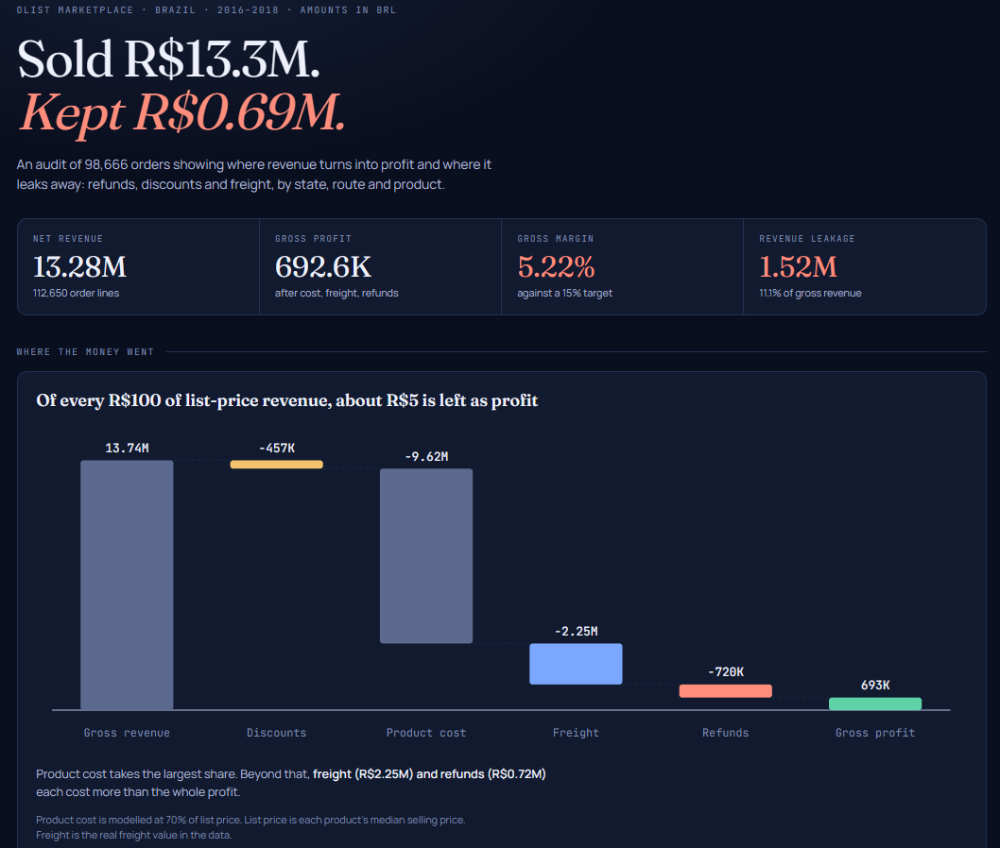
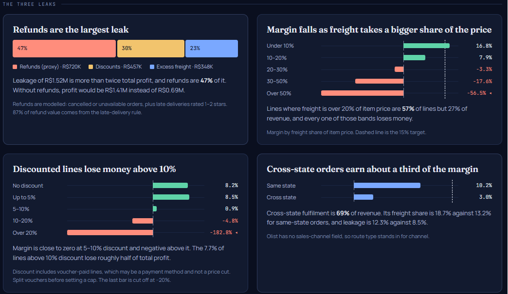
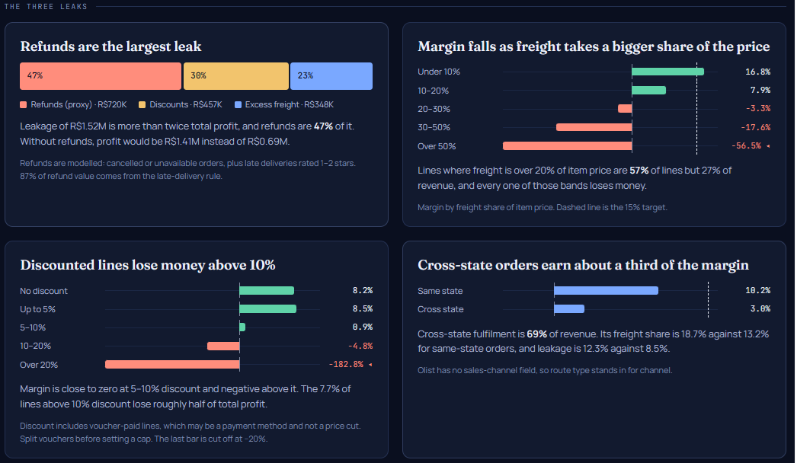
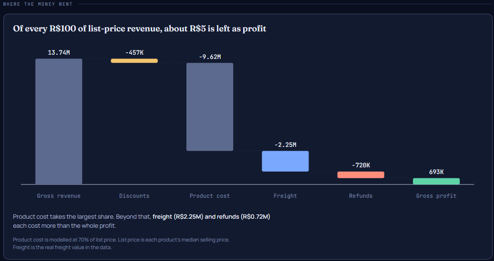

# Revenue Leakage & Margin Erosion Audit System

An end-to-end analytics project that finds where an e-commerce business loses revenue and profit, using 112,650 real order lines from the Olist Brazilian marketplace.

**[Live dashboard](https://yashtodankar.github.io/revenue-leakage-audit/dashboard.html)**

## Business problem
A company can have strong sales and still lose profit through refunds, discounts, high delivery costs, low-margin products and unprofitable regions. Management usually sees one revenue number and cannot tell where the money leaks. This project measures it.

## Pipeline
Raw CSV files → Python ETL (Pandas, NumPy) → MySQL (7-table schema) → 20 SQL audit queries → dashboard → recommendations

## Dataset
Olist Brazilian E-Commerce Public Dataset (Kaggle): 9 linked CSV files, about 100k orders, Sep 2016 to Oct 2018. Amounts are in Brazilian Real (BRL).

Olist has no cost, list price or refund fields, so these are modelled (see Assumptions).

## Tools
Python (Pandas, NumPy, SQLAlchemy), MySQL, SQL (CTEs, window functions, subqueries), HTML/JavaScript dashboard, Git/GitHub.

## Data model
Seven tables: `customers`, `products`, `orders`, `order_items` (fact table), `returns`, `shipping_costs`, `date_dim`.

## Data cleaning
- Joined 9 raw tables into one item-level table (112,650 rows).
- Converted dates, checked for delivery before purchase, duplicates and invalid prices (none found).
- Translated Portuguese product categories to English. 623 products had no category and were labelled "Unknown".
- Standardised city and state text.
- Capped voucher shares at the item price after the first run produced negative revenue and margins like -105,000%.
- Added calculated columns: gross revenue, discount, net revenue, product cost, shipping cost, refund, total cost, gross profit, margin %, revenue leakage.
- Four automated quality checks plus an audit log (`docs/audit_log.csv`). All pass.
- Reconciled MySQL totals against the source file (net revenue 13,279,397; profit 692,554).

## Assumptions
- **List price** = median selling price of each product. Selling below it counts as a discount.
- **Product cost** = 70% of list price (modelled).
- **Refund proxy** = cancelled or unavailable orders, plus delivered orders that arrived late with a 1–2 star review.
- **Excess freight** = freight above 30% of item price.
- **Margin threshold** = 15%.
- **Revenue leakage** = discount + refund + excess freight.

## SQL analysis
`sql/03_audit_queries.sql` has 20 queries covering leakage by category, product, customer, state and route; discount bands; pricing anomalies; refund impact; freight impact; and month-over-month margin. Results and notes are in `docs/findings.md`.

## Dashboard

## Key insights
- Net revenue was 13.28M and profit 0.69M, a **5.22% margin** against a 15% target.
- Leakage was **1.52M (11.1% of gross revenue)**, more than twice total profit. Refunds were about 47% of it, discounts 30% and excess freight 23%.
- Lines where freight exceeds 20% of item price are 57% of lines and have negative margins.
- Cross-state orders earned a 2.95% margin against 10.21% for same-state orders.
- Twelve states had negative margins. São Paulo earned about 68% of all profit.
- Margin fell from 8.6% to 2.0% in November 2017 while revenue rose 53%, and was negative in Feb and Mar 2018.
- Lines discounted above 10% had negative margins, though this includes voucher-paid lines.

## Recommendations
- If late-delivery refunds are confirmed as real, improve delivery on long routes first.
- If freight above 20% of price holds in real data, test minimum order values, freight surcharges or nearer-seller routing for low-priced items.
- Before capping discounts, separate vouchers from price cuts and rerun the analysis.
- If state and category rankings stay the same at 60% and 80% cost, act on the loss-making states.

## Limitations
- Cost, list price and refunds are modelled, so absolute profit figures are estimates. Rankings are more reliable than levels.
- Olist has no sales-channel field. Route type (same-state vs cross-state) is used as a proxy.
- Vouchers may be a payment method and not a price cut, which inflates the discount findings.
- Monthly results shown cover Jan 2017 to Mar 2018. Cost sensitivity at 60% and 80% has not been run yet.

## How to run
1. Put the Olist CSV files in `data/raw/Dataset/`.
2. Create a `.env` file with `DB_USER`, `DB_PASS`, `DB_HOST`.
3. `pip install pandas numpy sqlalchemy pymysql python-dotenv`
4. `python etl/01_etl_cleaning.py`
5. `python etl/01b_create_schema.py`
6. `python etl/02_load_mysql.py`
7. `python etl/03_run_all_queries.py`

## Author
Yash Todankar · [GitHub](https://github.com/Yashtodankar)